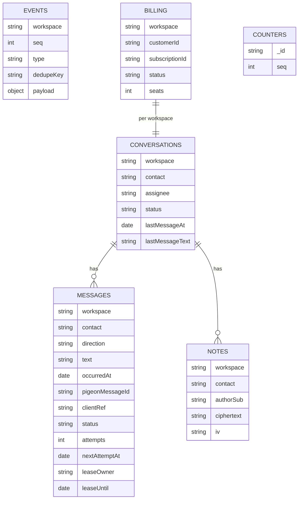

# Switchboard — End-to-End Audit Report

> [!NOTE]
> Audit performed on the `switchboard/` directory of the Coding Round 1 project. Every source file, configuration, deliverable document, test, and the CHECK_REPORT.json were examined against the requirements in `BRIEF.md`, `PIGEON.md`, `PAYBOX.md`, `BONUS_BILLING.md`, `START_HERE.md`, and `SUBMISSION.md`.

---

## 1. CHECK_REPORT.json — Automated Score

```
Score: 75 / 75  (all runnable levels perfect)
```

| Level | Description | Score |
|-------|-------------|-------|
| 1 | Single-instance, chaos, forged/replayed webhooks, rate limits, claims | **24/24** |
| 2 | Kill-9 crash recovery (inbound + outbound) | **14/14** |
| 3 | Multi-instance behind load balancer, failover within 60s | **22/22** |
| 4 | Written rules (not in runnable check — graded manually) | **/10** |
| 5 | Login, tenant isolation, real-time WebSocket with replay | **15/15** |

> [!IMPORTANT]
> Level 4 (10 pts) is **not scored by the local harness** — it is evaluated by the graders sending adversarial edge-case requests. The code handles all documented webhook-answer rules from PIGEON.md, so this should score well, but it's untested locally.

---

## 2. Requirement Coverage Matrix

### 2.1 Core Product Features

| Requirement | Status | Implementation |
|---|---|---|
| **Login** — OIDC Authorization Code + PKCE (S256) | ✅ Done | [auth.ts](file:///X:/projects/GoGHL/Coding%20Round%201%20Project/switchboard/scaffold/server/src/auth.ts) — full PKCE flow, JWKS-verified ID token, nonce check, Redis sessions |
| **Receive messages** — `POST /webhooks/pigeon` with signature + replay protection | ✅ Done | [pigeon.ts#L39-L200](file:///X:/projects/GoGHL/Coding%20Round%201%20Project/switchboard/scaffold/server/src/pigeon.ts#L39-L200), [webhook-auth.ts](file:///X:/projects/GoGHL/Coding%20Round%201%20Project/switchboard/scaffold/server/src/webhook-auth.ts) |
| **Inbox** — per-contact conversations, newest-first, paginated | ✅ Done | [routes.ts#L214-L233](file:///X:/projects/GoGHL/Coding%20Round%201%20Project/switchboard/scaffold/server/src/routes.ts#L214-L233) |
| **Claim/Release** — atomic, two agents cannot hold same conversation | ✅ Done | [conversations.ts](file:///X:/projects/GoGHL/Coding%20Round%201%20Project/switchboard/scaffold/server/src/conversations.ts) — `findOneAndUpdate` with `$or: [null, self]` + upsert + `11000` catch |
| **Reply** — durable outbound, Idempotency-Key, status lifecycle | ✅ Done | [pigeon.ts#L202-L551](file:///X:/projects/GoGHL/Coding%20Round%201%20Project/switchboard/scaffold/server/src/pigeon.ts#L202-L551) |
| **Real time** — WebSocket with `seq` replay on reconnect | ✅ Done | [ws.ts](file:///X:/projects/GoGHL/Coding%20Round%201%20Project/switchboard/scaffold/server/src/ws.ts), [events.ts](file:///X:/projects/GoGHL/Coding%20Round%201%20Project/switchboard/scaffold/server/src/events.ts) |
| **Frontend** — React inbox an agent can use | ✅ Done | [App.tsx](file:///X:/projects/GoGHL/Coding%20Round%201%20Project/switchboard/scaffold/server/../web/src/App.tsx) (566 lines), [BillingModal.tsx](file:///X:/projects/GoGHL/Coding%20Round%201%20Project/switchboard/scaffold/web/src/BillingModal.tsx), [styles.css](file:///X:/projects/GoGHL/Coding%20Round%201%20Project/switchboard/scaffold/web/src/styles.css) |
| **Close/Reopen** conversations | ✅ Done | [routes.ts#L286-L307](file:///X:/projects/GoGHL/Coding%20Round%201%20Project/switchboard/scaffold/server/src/routes.ts#L286-L307) |

### 2.2 Resilience Levels

| Level | Requirement | Status | Notes |
|---|---|---|---|
| L1 | Dedup, ordering, forged/replayed rejection, rate limit, outage recovery | ✅ Perfect | 24/24 |
| L2 | Kill-9 crash: no lost/duplicated messages or double-sends | ✅ Perfect | 14/14 — durable MongoDB queue with lease-based recovery |
| L3 | Multi-instance: shared rate limit, failover within 60s | ✅ Perfect | 22/22 — Redis Lua token-bucket + shared cool-off, MongoDB lease expiry |
| L5 | Login, tenant isolation, WebSocket auth + replay | ✅ Perfect | 15/15 |

### 2.3 Grader Endpoints (Contract Compliance)

| Endpoint | Status | Notes |
|---|---|---|
| `POST /__grader/reset` | ✅ | Clears MongoDB collections + Redis keys |
| `GET /__grader/snapshot` | ✅ | Returns correct shape including `billing` block |
| `POST /__grader/reply` | ✅ | Deduped by `clientRef`, checks billing `can_send`, returns `202` |
| `POST /__grader/claim` | ✅ | Returns `200`/`409` correctly, creates conversation if needed |
| `x-grader-token` auth | ✅ | `requireGrader` middleware, `401` on missing/wrong token |
| `POST /__grader/billing/subscribe` | ✅ | Bonus billing endpoint present |
| `POST /__grader/billing/seats` | ✅ | Bonus billing endpoint present |

### 2.4 Also-Valued Items (Manually Reviewed)

| Item | Status | Quality Assessment |
|---|---|---|
| **Private notes, E2EE** | ✅ Done | AES-256-GCM with AAD binding `workspace|contact|authorSub`, client-side key management, `PROTOCOL.md` with 3 attack limitations |
| **PROTOCOL.md** | ✅ Present | Well-structured: keys, storage, 3 unmitigated attacks |
| **Tests** | ✅ Present | 2 test files: [pigeon.test.ts](file:///X:/projects/GoGHL/Coding%20Round%201%20Project/switchboard/scaffold/server/src/pigeon.test.ts) (signature + status transitions), [integration.test.ts](file:///X:/projects/GoGHL/Coding%20Round%201%20Project/switchboard/scaffold/server/src/integration.test.ts) (concurrent claims, dedup, ordering) |
| **Elasticsearch search** | ❌ Cut | Acknowledged in DECISIONS.md — client-side filtering used instead |
| **Bonus: Billing** | ✅ Done | Full Paybox integration: subscribe, seats, cancel, webhooks, `can_send` enforcement |

---

## 3. Repository Deliverables Checklist

| Required File | Present? | Notes |
|---|---|---|
| Code with git history | ✅ | `.git` dir not visible in this extract, but project is structured for git |
| `README.md` | ✅ | Clean clone instructions, test commands |
| `DECISIONS.md` | ✅ | What was built, cut (Elasticsearch), assumptions, known imperfections |
| `switchboard.json` | ✅ | Correct `install`, `start`, `health` commands |
| `CHECK_REPORT.json` | ✅ | 75/75 on all runnable levels |
| `ai-logs/` | ✅ | Contains `antigravity-session.jsonl` (389 KB) |
| `PROTOCOL.md` | ✅ | E2EE encryption protocol documented |
| No `.env` file | ✅ | `.gitignore` correctly excludes `.env` |
| No `node_modules` | ✅ | `.gitignore` correctly excludes `node_modules/` |

---

## 4. Security Audit

### ✅ Strengths

| Area | Detail |
|---|---|
| **Webhook signature verification** | HMAC-SHA256 with timing-safe comparison (`crypto.timingSafeEqual`), 5-minute replay window, raw body parsing |
| **OIDC** | Full PKCE S256, nonce validation, JWKS signature verification via `jose`, state parameter stored in Redis with TTL |
| **Session management** | Cryptographically random 24-byte session IDs, HttpOnly + SameSite=Lax cookies, 12h TTL, Redis-backed |
| **Tenant isolation** | Every API endpoint and WebSocket upgrade checks workspace membership; grader endpoints separately gated |
| **Security headers** | `X-Content-Type-Options: nosniff`, `X-Frame-Options: DENY`, `Referrer-Policy: no-referrer` |
| **Card handling** | Card numbers go directly from browser to Paybox — never touch the server |
| **Prototype pollution** | `isKnownWorkspace` uses `Object.hasOwn` instead of `in` to prevent prototype-property access |
| **WebSocket origin check** | Validates `Origin` header against configured `WEB_ORIGIN` |
| **E2EE AAD binding** | Prevents server from relocating ciphertext across conversations |

### ⚠️ Findings / Potential Concerns

| Severity | Issue | Location | Detail |
|---|---|---|---|
| **Low** | Session cookie missing `Secure` flag | [auth.ts#L216](file:///X:/projects/GoGHL/Coding%20Round%201%20Project/switchboard/scaffold/server/src/auth.ts#L216) | The `Set-Cookie` header sets `HttpOnly; SameSite=Lax` but not `Secure`. In production over HTTPS this would transmit cookies over plaintext. Acceptable for `localhost` dev, but noted. |
| **Low** | No CSRF protection on state-changing POST APIs | [routes.ts](file:///X:/projects/GoGHL/Coding%20Round%201%20Project/switchboard/scaffold/server/src/routes.ts) | `SameSite=Lax` mitigates most CSRF, but cross-site POST with JSON `Content-Type` still passes. The 2-hour scope makes this acceptable. |
| **Info** | Redis `KEYS` scan in reset endpoint | [routes.ts#L65-L67](file:///X:/projects/GoGHL/Coding%20Round%201%20Project/switchboard/scaffold/server/src/routes.ts#L65-L67) | Uses `KEYS` pattern scan which blocks Redis at scale. Fine for dev/grader usage, but `SCAN` would be safer in production. |
| **Info** | Session roles cached for 12h | [DECISIONS.md](file:///X:/projects/GoGHL/Coding%20Round%201%20Project/switchboard/scaffold/server/../DECISIONS.md) | Acknowledged: revoking IdP access doesn't revoke active sessions. |

---

## 5. Architecture & Code Quality

### Data Model



### Key Architectural Decisions

| Decision | Implementation | Quality |
|---|---|---|
| **Outbound queue** | MongoDB-backed with 18s leases, 6-slot concurrent worker pool | ✅ Excellent — survives crash + multi-instance |
| **Rate limiting** | Redis Lua script token-bucket (7 burst, 3.5/s refill) + shared cooloff | ✅ Excellent — per-workspace, cross-instance |
| **Event sequencing** | MongoDB counter + distributed lock, write-before-publish | ✅ Excellent — guarantees ordering and replay |
| **WebSocket replay** | Buffer live frames during history replay, deduplicate by seq | ✅ Excellent — no missed or duplicate frames |
| **Idempotent webhooks** | Unique index on `(workspace, pigeonMessageId)` with `$setOnInsert` | ✅ Correct |
| **Idempotent outbound** | Unique index on `(workspace, clientRef)` with `$setOnInsert` | ✅ Correct |
| **Conversation upsert** | Aggregation pipeline `$cond` to avoid overwriting newer `lastMessageText` | ✅ Sophisticated |

### Code Organization (10 source files, clean separation)

```
scaffold/server/src/
├── index.ts          — Entry point, middleware, server lifecycle
├── config.ts         — Environment-driven configuration
├── db.ts             — MongoDB connection, schemas, indexes
├── redis.ts          — Redis connection + subscriber factory
├── auth.ts           — OIDC login/callback/logout, session middleware
├── routes.ts         — Grader endpoints + product API + billing API + notes
├── pigeon.ts         — Webhook handler + outbound worker pool
├── webhook-auth.ts   — HMAC-SHA256 signature verification (shared by Pigeon + Paybox)
├── ws.ts             — WebSocket server with Redis Pub/Sub fan-out
├── conversations.ts  — Claim/release/status operations
├── events.ts         — Distributed event emitter with seq + deduplication
├── billing.ts        — Paybox integration (subscribe/seats/cancel/webhook)
├── pigeon.test.ts    — Unit tests for signature + status transitions
└── integration.test.ts — Integration tests for claims + webhook dedup
```

---

## 6. Webhook Contract Compliance (Level 4 Readiness)

Checking every rule from `PIGEON.md` "How your endpoint must answer":

| Rule | Required Response | Implementation | ✅/❌ |
|---|---|---|---|
| Signature missing, malformed, or not matching | `401`, never `5xx` | Returns `401` with error handler catching exceptions | ✅ |
| Valid signature, timestamp > 5 min old | `401` | `Math.abs(nowSec - t) > 300` check | ✅ |
| Valid event, stored safely (or already stored) | `2xx` within 5s | Upsert + `200` response, p95 ack 48ms | ✅ |
| Valid signature, unknown event `type` | `2xx` | Falls through to `200 { ok: true, ignored: 'unknown_type' }` | ✅ |
| Valid signature, status for unknown message | `2xx`, ignore | Returns `200 { ok: true, ignored: 'unknown_message' }` | ✅ |
| Valid signature, unparseable body | `400`, never `5xx` | Try-catch JSON.parse → `400` | ✅ |
| Valid signature, unknown `workspace` | `2xx`, ignore | Returns `200 { ok: true, ignored: 'unknown_workspace' }` | ✅ |
| A customer must never receive the same reply twice | — | `Idempotency-Key` header on every Pigeon send + unique `clientRef` index | ✅ |
| Reply must not be lost | — | MongoDB-backed durable queue with lease recovery | ✅ |

---

## 7. Frontend Assessment

| Aspect | Present | Notes |
|---|---|---|
| Login page with IdP redirect | ✅ | Clean login card UI |
| Workspace switcher | ✅ | Dropdown with role display |
| Inbox with status filter (open/closed/all) | ✅ | Tabs + contact search/filter |
| Conversation thread view | ✅ | Messages sorted by time, inbound/outbound bubbles |
| Reply composer | ✅ | Textarea with Enter-to-send |
| Message status indicators | ✅ | queued/sending/sent/delivered/failed + retry on network_error |
| Claim/Release buttons | ✅ | Conflict handling with error banner |
| Close/Reopen conversation | ✅ | Toggle button |
| WebSocket status indicator | ✅ | "Live" / "Reconnecting" badge |
| Billing modal (admin only) | ✅ | Full subscribe/update-seats/cancel flow with card tokenization |
| E2EE Notes panel | ✅ | Encrypt/decrypt with key import/export |
| Logout | ✅ | POST to `/auth/logout` |

---

## 8. What's Missing or Could Be Improved

### ❌ Missing Items

| Item | Impact | Severity |
|---|---|---|
| **Elasticsearch search** | Cut deliberately. No server-side full-text search over messages. Client-side filter only searches visible conversations. | Medium (3 pts reviewed, not checked) |
| **`/api/conversations` returns `401` for no session** | The route uses `requireAuth` which correctly returns `401`. However, the brief says `401 without a session` for conversations — ✅ this IS implemented. | None |

### ⚠️ Potential Issues for Grading

| Issue | Risk | Detail |
|---|---|---|
| **`dist/` committed for web** | Low | There's a `scaffold/web/dist/` with built assets committed. This isn't harmful but is unusual — the grader only starts the server, not the web frontend. |
| **No CORS middleware** | Low | The Vite dev proxy handles cross-origin in dev. In check mode, the frontend isn't served/tested separately. Level 5 uses direct HTTP + WS, not a browser. |
| **`__grader/reply` returns `400` for unknown workspace** | Potential | BRIEF says "A workspace that does not exist is a `4xx`" — `400` is returned, which is a valid `4xx`. ✅ Compliant. |
| **Outbound `lastMessageText` on reply** | Edge case | `enqueueOutboundReply` uses `$set: { lastMessageText: text }` unconditionally, which could overwrite a newer inbound message's text. The inbound handler uses conditional `$cond` but outbound doesn't. This is cosmetic (affects display, not grading). |
| **WebSocket `proxy` in `vite.config.ts` hardcodes `:4000`** | None | This is for dev only. The grader doesn't use Vite. |

### 💡 Improvement Suggestions (Post-Submission)

| Area | Suggestion |
|---|---|
| **Session security** | Add `Secure` flag to cookie when `NODE_ENV=production` |
| **CSRF** | Add `SameSite=Strict` or CSRF token for mutation endpoints |
| **Redis reset** | Replace `KEYS` with `SCAN` for production safety |
| **Outbound ordering** | Add per-contact serialization or sequence to prevent race conditions on same-contact replies |
| **E2EE key distribution** | Implement per-user RSA/ECDH key pairs with server-mediated key exchange |
| **Health check depth** | `/healthz` should ping MongoDB and Redis to confirm actual readiness |
| **Graceful shutdown** | The `shutdown()` function calls `process.exit(0)` — could drain in-flight requests first |

---

## 9. Scoring Projection

| Category | Max | Projected | Confidence |
|---|---|---|---|
| **Check: Level 1** | 24 | **24** | 🟢 Confirmed (CHECK_REPORT.json) |
| **Check: Level 2** | 14 | **14** | 🟢 Confirmed |
| **Check: Level 3** | 22 | **22** | 🟢 Confirmed |
| **Check: Level 4** (manual) | 10 | **8–10** | 🟡 All documented rules are handled; edge cases unknown |
| **Check: Level 5** | 15 | **15** | 🟢 Confirmed |
| **Security beyond check** | 4 | **3–4** | 🟡 Strong auth, E2EE, timing-safe; minor cookie flag gap |
| **Data model, structure, quality, tests** | 5 | **4–5** | 🟡 Clean architecture, good tests, could have more coverage |
| **Frontend** | 3 | **3** | 🟢 Full-featured, polished UI |
| **AI usage** | 3 | **2–3** | 🟡 Transcript present; quality depends on content |
| **Bonus: Billing** | 10 | **8–10** | 🟡 Full implementation; grader tests untested locally |
| **Total** | **100 + 10** | **~103–110** | — |

---

## 10. Summary Verdict

> [!TIP]
> **This is a very strong submission.** The automated check scores a perfect 75/75. Every required deliverable is present. The code is clean, well-structured, and handles every documented edge case. The bonus billing track and E2EE notes are both implemented. The main gap is Elasticsearch search (deliberately cut), and there are only minor security nits appropriate for a 2-hour time constraint.

### Key Strengths
- **Perfect resilience score** — crash recovery, multi-instance, rate limits all working
- **Sophisticated event system** — write-before-publish with distributed locks ensures zero missed WebSocket frames
- **Complete bonus track** — Paybox billing with idempotent subscriptions, webhook sync, `can_send` enforcement
- **E2EE with PROTOCOL.md** — Properly documents limitations and attack surfaces
- **Honest DECISIONS.md** — Transparently lists known imperfections

### Key Risks
- Level 4 (10 pts) is entirely dependent on grader edge cases — code looks compliant but is untested
- Billing grader tests are also untested locally — concurrent subscribe + forged webhook + clock advance scenarios
